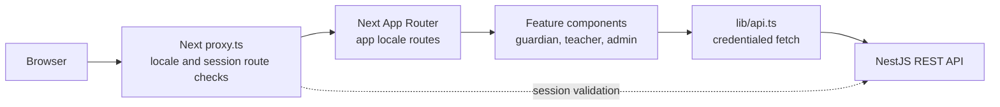

# Madrasty Client

Madrasty is a school-agnostic school-management platform. This repository contains the Arabic/English web application used by guardians, teachers, and school administrators to access student records and school workflows.

The current frontend implements:

- Guardian sign-in using a student national ID and a WhatsApp verification code, followed by attendance, behavior, homework, and timetable views for linked students.
- Teacher sign-in and a quick portal for class rosters, attendance sessions, behavior entries, homework, and the teacher timetable.
- School-administrator views for timetable drafts, editing and publishing, plus a communication log.
- A public landing page and English/Arabic interfaces.

These pages call the Madrasty NestJS API; persistence, authorization, OTP delivery, and notification delivery are implemented by the backend. Some administrative capabilities exist only as API or data-model support and do not have a frontend workflow. See the [backend README](https://github.com/Ahmed-Soliman777/madrasty-server/blob/main/README.md) for backend scope and setup.

## Architecture

### Rendering, routes, and state

- **Next.js App Router** organizes localized pages under `app/[locale]`. `next-intl` supports `/ar` and `/en`; Arabic is the default and the document direction is set to RTL.
- Server components render the landing and route shells; interactive login, guardian, staff, and timetable screens use client components.
- `proxy.ts` handles locale routing and checks protected guardian/staff routes by validating the session with the backend. It is not an API proxy.
- Feature code lives in `features/`; reusable authentication and layout elements live in `components/`. UI state is managed locally with React hooks; there is no global state library.
- `lib/api.ts` is the shared `fetch` client. It sends browser credentials, disables caching for API requests, parses error messages into `ApiError`, and reports a backend-unavailable error when a request cannot reach the server.
- Forms use native inputs and component-level validation/state. There is no separate form or schema-validation library in the frontend.



### Authentication and access control

Guardian sign-in requests an OTP using the student national ID; the backend sends the code through its linked WhatsApp session. Staff sign in with email and password. The frontend marks web sign-ins with `X-Client-Type: web`; the backend sets an HttpOnly `accessToken` cookie. Subsequent browser API calls use `credentials: "include"`.

The route proxy calls the backend session endpoint to validate that cookie and routes guardians to `/home` and teachers or school administrators to `/staff`. The staff page accepts only `TEACHER` and `SCHOOL_ADMIN` roles. Backend authorization remains authoritative; frontend route checks are not a replacement for API authorization.

The app does not expose a Next.js API route for forwarding backend requests. Browser feature requests go directly to the configured backend URL. Only session validation runs from the Next.js server.

### Styling, localization, and responsive behavior

Tailwind CSS 4 is used with the project’s shared CSS theme in `app/globals.css`. Components use responsive utility classes. `next-intl` loads the matching JSON message catalog from `messages/en.json` or `messages/ar.json`; locale-aware pages set Arabic RTL and English LTR.

## Technology stack

| Area | Verified implementation |
|---|---|
| Framework / rendering | Next.js 16.3.5 App Router |
| Language | TypeScript (`^5`) and React 19.2.8 |
| UI | React components and `lucide-react` icons; no component framework |
| Styling | Tailwind CSS 4 (`tailwindcss` and `@tailwindcss/postcss`) |
| Internationalization | `next-intl` 4.14.7 |
| API | Browser/server `fetch` in `lib/api.ts` |
| Forms | Native inputs and component-level validation; no form library |
| Tests | No frontend test files or test script are currently present |
| Build / quality | Next.js scripts, ESLint 9, TypeScript 5 |

## Prerequisites

- Node.js compatible with Next.js 16 (`>=20.9.0`). For running the frontend and backend together, use Node 22.12+ or Node 24+, which also meet the installed Prisma 7 engine requirements.
- npm with lockfile support. The repository includes `package-lock.json`; use `npm ci` for a reproducible install.
- A running Madrasty backend and PostgreSQL database for sign-in and data-backed pages.
- For guardian OTP delivery, a backend WhatsApp session must be linked. See the [backend setup](https://github.com/Ahmed-Soliman777/madrasty-server/blob/main/README.md#running-the-backend-locally).

No Node version file or `.env.example` is currently provided.

## Environment variables

Create `.env.local` in the repository root if you need to override the local defaults:

| Variable | Required | Purpose |
|---|---:|---|
| `NEXT_PUBLIC_API_BASE_URL` | No | Backend origin used by browser API calls. Defaults to `http://localhost:5000`; provide the origin only, without `/api`. This value is public in the browser bundle. |
| `BACKEND_API_URL` | No | Backend origin used by server-side session checks. Defaults to `NEXT_PUBLIC_API_BASE_URL`, then `http://localhost:5000`. |
| `NODE_ENV` | No; managed by Next.js | Used when clearing an expired session cookie to set its `Secure` attribute in production. Normally do not set it manually. |

Example for local development:

```env
NEXT_PUBLIC_API_BASE_URL=http://localhost:5000
BACKEND_API_URL=http://localhost:5000
```

Keep `.env.local` private; `.env*` files are ignored by Git. Configure the backend’s `FRONTEND_ORIGINS` to include the exact frontend origin (default `http://localhost:3000`) for credentialed browser requests. Cookie domain and production cookie behavior are configured on the backend, not here.

## Running the frontend locally

Clone the repository, then install dependencies:

```bash
git clone https://github.com/Ahmed-Soliman777/madrasty-client.git
cd madrasty-client
npm ci
npm run dev
```

If needed, create `.env.local` as above before starting. The development server uses port **3000** by default. Open [http://localhost:3000](http://localhost:3000); the locale middleware routes to Arabic by default, with English available under `/en`. To use another port, pass the Next.js CLI option:

```bash
npm run dev -- --port 3001
```

For production:

```bash
npm run build
npm run start
```

`npm run start` serves the production build on port 3000 by default. Configure the backend URL variables in the production environment before building/running. To use another port, pass `--port` to `next start`, for example `npm run start -- --port 3001`.

## Running client and server together

1. Prepare PostgreSQL and start the backend first. Follow the [backend README](https://github.com/Ahmed-Soliman777/madrasty-server/blob/main/README.md#running-the-backend-locally).
2. Set backend `DATABASE_URL`, `JWT_SECRET`, and `FRONTEND_ORIGINS=http://localhost:3000`.
3. Ensure the backend is listening on `http://localhost:5000`. The frontend API uses `/api/...` routes on this origin.
4. Configure backend data and link WhatsApp if you need to exercise sign-in and notifications. The repository seed is not a blank-database bootstrap; see the backend README.
5. In this repository, create `.env.local` with:

   ```env
   NEXT_PUBLIC_API_BASE_URL=http://localhost:5000
   BACKEND_API_URL=http://localhost:5000
   ```

6. Run `npm ci` and `npm run dev`, then open `http://localhost:3000`.
7. Browser requests include credentials. Backend CORS must allow the exact frontend origin. The backend sets an HttpOnly, SameSite=Lax cookie for web sign-ins; local development does not require a cookie-domain override.

## Testing and code quality

The current `package.json` provides:

```bash
npm run lint
npx tsc --noEmit
npm run build
```

- `npm run lint` runs ESLint.
- `npx tsc --noEmit` runs the TypeScript compiler directly; there is no dedicated type-check script.
- `npm run build` verifies and builds the Next.js application.
- There are currently no frontend unit, integration, or end-to-end test files and no `test` script.

## Troubleshooting

| Symptom | Check |
|---|---|
| API requests report backend unavailable | Confirm the backend is running and `NEXT_PUBLIC_API_BASE_URL` is the backend origin (without `/api`). |
| Staff or guardian routes return to sign-in | Confirm the backend can validate `/api/auth/me`, the browser retained the `accessToken` cookie, and the account role is supported by the frontend route. |
| Browser reports a CORS error | Set backend `FRONTEND_ORIGINS` to the exact browser origin, including scheme and port. Credentialed requests cannot use a wildcard origin. |
| OTP is not received | OTP delivery is provided by the backend’s linked WhatsApp session; see the backend README. |
| Port 3000 is occupied | Stop the other process or run the Next.js CLI with a different port and add that exact origin to backend `FRONTEND_ORIGINS`. |
| Build fails after dependency changes | Use the Node version required by Next.js/Prisma, reinstall with `npm ci`, then run `npm run build`. |

## Project structure

```text
app/
  [locale]/             Localized landing, authentication, guardian, and staff routes
  globals.css           Shared theme and global styles
components/
  auth/                 Login and OTP components
  layout/               Shared layout components
  staff/                Staff navigation and page header
  ui/                   Small reusable UI primitives
features/
  parent-home/          Guardian dashboard
  teacher-quick/        Teacher and school-administrator screens
  timetable/            Guardian, teacher, and admin timetable views
  comms/                Notification communication log
i18n/                   Locale routing, navigation, and message loading
lib/api.ts              Backend API client and response types
messages/               English and Arabic translations
proxy.ts                Locale routing and protected-route session checks
```

## Related documentation

- [Madrasty Server README](https://github.com/Ahmed-Soliman777/madrasty-server/blob/main/README.md)
